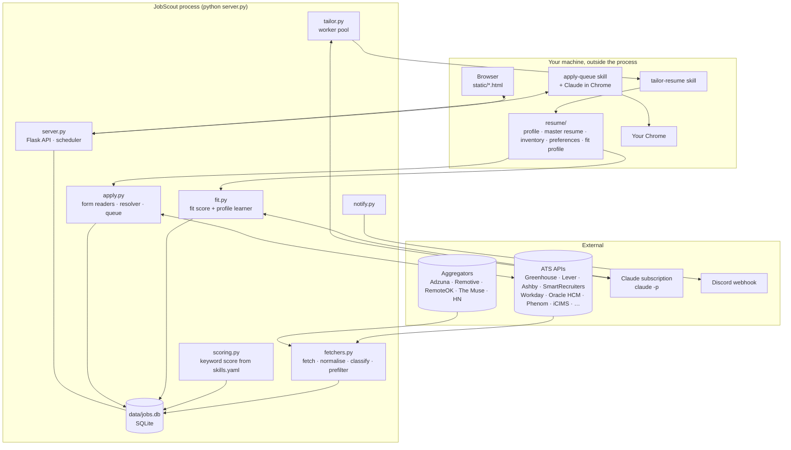
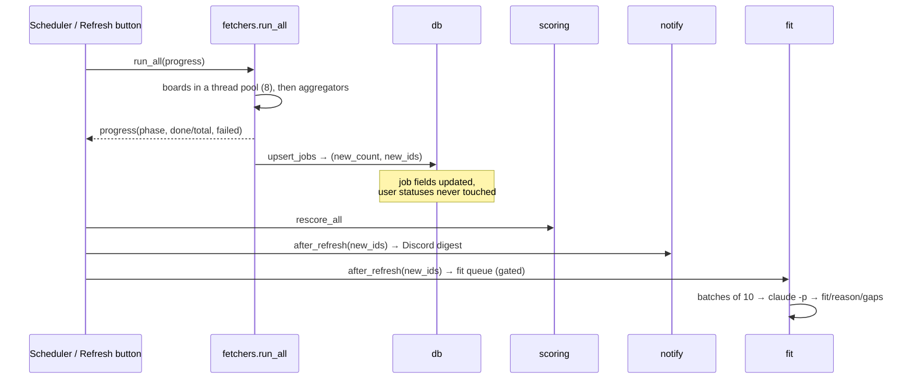

# Architecture

One Python process, one SQLite file, a vanilla-JS front end, and two Claude Code skills that
run outside the process. The deeper, maintainer-level notes are in
[Internals → Architecture notes](../ARCHITECTURE.md).

## System view

## Data flow of a refresh

## Components

| Module | Responsibility |
|---|---|
| `fetchers.py` | One function per ATS/aggregator, all funnelled through `_norm()` (normalised job shape), `is_relevant()` (the preset's prefilter), `_keep_location()` (your location policy), `classify_location()` / `detect_work_mode()`. `home()` compiles Settings → Home. |
| `scoring.py` | `Scorer` built from `config/skills.yaml`; `rescore_all` recomputes every row and self-heals location classes. |
| `fit.py` | Gate → batches → `claude -p` → strict JSON; worker pool; `update_profile()` rewrites `resume/fit-profile.md` from feedback. |
| `tailor.py` / `inventory.py` | Runs the `tailor-resume` skill headlessly per job (analyze → questions → generate); `inventory.py` is the only writer of `skills-inventory.md`. |
| `apply.py` | Form readers (Greenhouse API, Ashby GraphQL, Lever HTML), the field resolver from `profile.yaml`, review/approve, the queue the filler drains. |
| `notify.py` | Discord digest of new jobs above `notify.min_score`. |
| `server.py` | Flask API, static pages, the refresh scheduler, the dual-loopback listener. |
| `db.py` | SQLite schema and idempotent migrations; `upsert_jobs` returns `(count, new_ids)`. |
| `detect.py` / `discover.py` | Which ATS does a company use? Slug probing and careers-page fingerprinting, single or bulk. |
| `.claude/skills/*` | The two Claude Code skills (tailor-resume, apply-queue). |

## Storage

- `data/jobs.db` - `jobs` (one row per source posting; `fingerprint` collapses duplicates at read
  time), `resume_runs`, `resume_answers`, `apply_runs`, `fit_feedback`, `meta`.
- `resume/` - your fact files plus `output/<Company>/<Role>/<id>/` per tailored job.
- `config/` - `settings.yaml` defaults, `local.yaml` your overrides and keys (gitignored),
  `skills.yaml` the active profile, `presets/`, `companies.yaml`, `watchlist.yaml`.

## Trust boundaries

Outbound traffic goes to the configured job sources, to Discord if you set a webhook, and to
Claude through `claude -p` (your subscription). The server binds loopback only. The filler
acts inside your Chrome with your sessions and stops at every login wall, captcha, or
unplanned question. See [Privacy and safety](../operations/privacy-and-safety.md).
