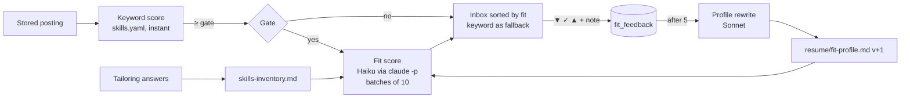

# Scoring and fit

Two scores, one you look at.

## Keyword score

Computed by `scoring.py` from `config/skills.yaml`, clamped to 0-100:

| Part | Source | Typical points |
|---|---|---|
| Title match | best `role_titles` entry (regex, label, points) | up to 30 |
| Seniority | `seniority_bonus` on the title | +6 |
| Skills | `skills.groups` found in the description; each group scores once plus a little per extra term; capped | up to 40 |
| Location | `location_points` by class (`home`, `home_state`, `remote_us`, …) | −50 … +15 |
| Experience fit | `experience_bonus` regex on the description | +4 |
| Freshness | `freshness_bonus` by posting age | +2 … +6 |
| Source | `source_points.direct` | +3 |
| Flags | citizenship/clearance, ITAR, export notice, no-sponsorship, contract | −60 … 0 |

`title_blockers` zero the score outright (interns, directors, sales, hardware "reliability"…);
`title_penalties` lower it with an `unless` escape for ops context. **Rescore** reapplies the
file to every stored job in a second. The role label of the best title match becomes the
`role` facet used by the Roles filter and the Role view.

The keyword score is deliberately simple. Its job is to be a cheap prefilter and an honest
fallback, not to be right.

## Fit score

Jobs that pass the gate (inbox, in-policy location, keyword ≥ `fit.gate_min_score`) go in
batches of ten to a cheap model (`claude-haiku-4-5` by default) through `claude -p` with:

- the judgement rules in `resume/fit-profile.md`,
- your `skills-inventory.md` (levels matter: *have / familiar / dont-have*),
- your `preferences.md` (location, work mode, deal-breakers),
- each job's title, location and the first 1,800 characters of its description.

The reply is strict JSON per job: `fit` 0-100, a one-line `reason`, up to three `gaps`. The
card shows all three. Thinking budget, batch size, parallelism and the gate are settings.

New jobs are scored automatically after every refresh; **Fit-score** on the Jobs page scores
ticked jobs on demand. Stored under the profile version that produced them.

## The learning loop

Each fit line has ▼ *too high* / ✓ / ▲ *too low*; the two edges ask for one sentence of why.
Feedback accumulates in the database. After `fit.auto_profile_after` items (default 5), or on
Settings → *Update profile now*, a stronger model rewrites `fit-profile.md`:

- keeps every rule not contradicted,
- adds concrete, reusable rules under *Learned adjustments* (role pattern → score band, with
  the why),
- never invents skills you did not claim,
- keeps a timestamped backup next to the file and refuses a reply that lost the structure.

The version bumps, every scored job becomes *stale*, and the gated ones re-score. Tailoring
answers flow into the inventory separately, so those sharpen fit scores too.

!!! example "What one thumbs-down did"
    The first real feedback was a DBA-flavoured SRE posting marked *too high* with "I know
    distributed-systems and relational-database concepts, not one engine's internals". The
    rewritten profile gained a rule capping database-specialist SRE roles at 50-55; the next
    pass moved two such jobs from the low 60s to 50 while a general SRE II scored 93.

## Which number the UI uses

- Sort "fit" (default): fit-scored jobs first by fit, then the rest by keyword score.
- The min-score slider reads `COALESCE(fit, score)`.
- Score box colour follows the same number.
