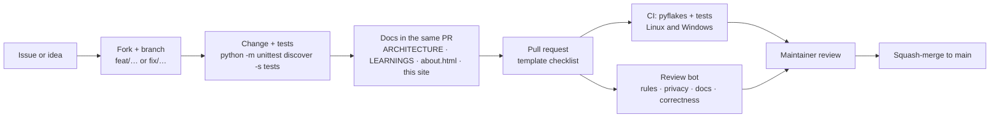
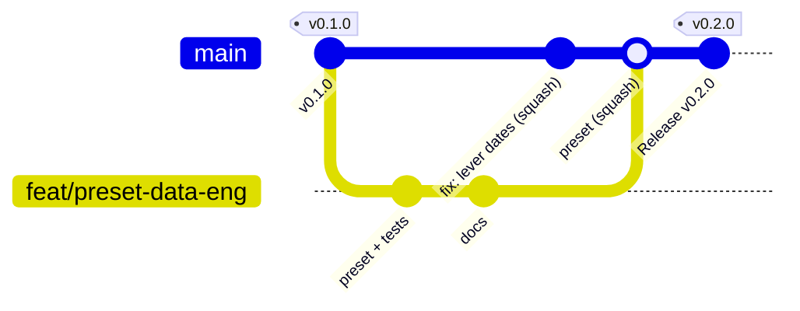

# Contributing

The short version lives in the repo's
[CONTRIBUTING.md](https://github.com/vikaspalakurthi/jobscout/blob/main/CONTRIBUTING.md); this
page is the walk-through.

## The flow

1. **Start from an issue** when the change is more than a fix - the three templates (bug,
   feature, company board) ask for exactly what reviewers need.
2. **Branch** from `main`: `feat/<slug>` or `fix/<slug>`. `main` must always run.
3. **Change + test.** `tests/test_smoke.py` is offline and fast; add a case when you touch a
   classifier, a resolver or a preset. `python -m pyflakes .` must be clean.
4. **Docs in the same PR.** The repo treats its docs as the source of truth:
   `docs/ARCHITECTURE.md` for flow/schema/endpoints, `docs/LEARNINGS.md` for any external
   quirk you hit, `static/about.html` when sources or filtering change, and the relevant page
   of this site. CI will not catch a stale doc; reviewers will.
5. **PR template.** Tick the boxes honestly; the review bot reads them.
6. **Review.** The Claude review bot comments within minutes (category rule, privacy, docs,
   correctness); a maintainer follows. One concern per PR keeps this fast.

## Good first contributions

- **A role preset** - one YAML file, see [Role presets](reference/presets.md). Software
  engineer, data engineer and SAP/ERP are wanted.
- **A board fetcher** for a category-1 or category-2 ATS not yet covered, or a fix to one.
  Read [Sources](concepts/sources.md) first.
- **Classifier fixes** in `fetchers.py` (location, work mode, employment type) with the failing
  string added to the tests.
- **Companies** - config, not code: `config/companies.yaml` with the `detect.py` output in the PR.
- **Apply readers** for flows that currently end `held` without a login wall (Phenom's native
  wizard, Dice's profile-driven wizard).

## Rules that are not up for discussion

- Legitimate APIs only. No LinkedIn/Indeed scraping, no bot-protection or login bypass, no
  captcha solving, no account creation.
- The filler never submits a form that differs from the approved plan and never fabricates.
- Nothing personal in tracked files; `resume/`, `data/`, `config/local.yaml` stay ignored.
- User statuses survive every refresh.

## Branching and releases

- `main` is protected (no force-push, no deletion, linear history) and always runnable.
- Work on a short-lived branch in your fork, open a PR, get it **squash-merged** - one PR, one
  commit. Label it (`enhancement`, `bug`, `board`, `preset`, `documentation`): the labels group
  the release notes.
- Versions are semver `0.y.z`: breaking changes (anything in the
  [upgrading table](operations/upgrading.md#breaking-changes-log)) bump `y`, everything else
  bumps `z`. Add a line to `CHANGELOG.md` → *Unreleased* in your PR.
- The maintainer cuts releases by tagging `main` (`vX.Y.Z`); the Release workflow runs the
  tests, checks the tag against `VERSION`, and publishes the notes. There are no packages -
  JobScout runs from a clone.
- Commits are authored by the person who made them; no AI co-author trailers.

## Developing

- `python server.py` (restart after Python edits); `JOBSCOUT_PORT=8766 python server.py` for a
  second instance beside a running one.
- `python perf.py` keeps endpoints under 500 ms.
- `mkdocs serve` previews this site (`pip install -r requirements-docs.txt`).
- Windows is a first-class platform; CI runs there.
- The repo is built with AI coding sessions following `CLAUDE.md`. Human contributors follow
  the same conventions; the file is short.

## Code of conduct and security

[CODE_OF_CONDUCT.md](https://github.com/vikaspalakurthi/jobscout/blob/main/CODE_OF_CONDUCT.md) ·
[SECURITY.md](https://github.com/vikaspalakurthi/jobscout/blob/main/SECURITY.md). Never put
anyone's resume, profile or application details in an issue or PR - including your own.
