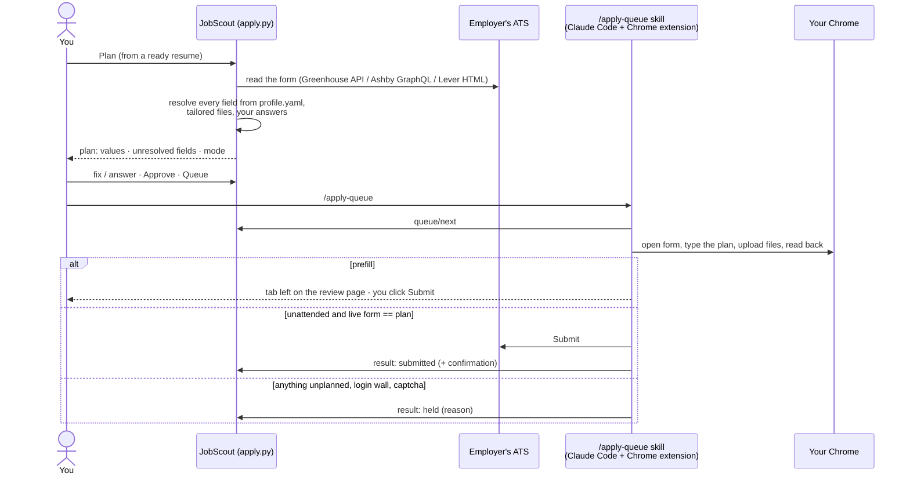

# Applying

From a ready resume to a submitted application, with you in the loop at exactly one point:
the plan review. The filler fills; it never decides.

## Stage 1 - the plan (`apply.py`)

**Plan** reads the employer's form - Greenhouse's job-board API with `?questions=true`, Ashby's
posting GraphQL, Lever's apply page - and resolves each field:

| Field kind | Resolved from |
|---|---|
| name, email, phone, location, LinkedIn, website/portfolio, GitHub | `profile.yaml` |
| resume, cover letter (file or text) | the tailored job folder; a missing cover letter is generated on demand |
| work authorization, sponsorship, relocation, start date, years, 18+, previously employed, referral, how heard | `profile.yaml` (booleans map to Yes/No options; referral is never your own name) |
| salary | `profile.salary` policy: a range answer, a target, or "Negotiable" |
| EEO / voluntary self-identification | `profile.eeo` (answer or decline), matched to the form's option wording |
| consents | `profile.consents`; each checkbox listed separately for explicit approval |
| custom essay questions | drafted from the tailored resume and the posting (*Draft answers*); optional ones are drafted too, never left blank silently |
| anything else | shown as **needs input** - you type it, or the plan stays unapproved |

The review card on the Resumes tab shows every value with its source. **Fix** edits a value,
**Approve** locks the plan, **Queue** hands it to the filler. Each plan carries a mode: *prefill*
(default) or *unattended* (only for boards in `apply.allowed_ats` without a captcha).

## Stage 2 - the filler (`/apply-queue`)

In a Claude Code session with the Chrome extension connected, type `/apply-queue`. The skill
pulls queued plans one at a time (up to `apply.max_per_run`), opens the form in your Chrome,
types exactly the planned values, uploads the planned files, reads every field back, and:

- **prefill**: leaves the tab on the review page for your Submit;
- **unattended**: submits only when the live form matches the approved plan exactly - any
  extra required field, changed option set, captcha or login wall → `held` with the reason.

Outcomes land on the card: *prefilled*, *submitted* (also marks the job applied and writes
`applied.md` in the job folder), *held*, *failed*. **Mark submitted** records a prefill you
submitted yourself. Marking a job applied by hand drops any queued plan so nothing is applied
twice.

!!! info "What the filler will not do"
    Solve captchas, log in, create accounts, type passwords, guess an answer, or submit a form
    that differs from the plan. Those are rules in the skill, not settings.

## What works where

| Board | Plan | Fill | Unattended |
|---|---|---|---|
| Greenhouse (incl. embedded careers pages) | API | yes | yes (invisible reCAPTCHA has not challenged so far) |
| Ashby | GraphQL | yes (EEO survey added from the profile) | yes |
| Lever | page parse | yes | no (hCaptcha) → prefill only |
| SmartRecruiters | fill-time discovery | yes (shadow DOM) | no |
| Dice (via Adzuna landings) | profile-driven wizard | yes; tailored resume swapped in | no |
| Workday, Oracle Recruiting, iCIMS, amazon.jobs | - | login wall → held | - |
| Phenom native wizards | no reader yet | held | - |

The platform-by-platform lessons from ~70 live runs are in
[Internals → Learnings](../LEARNINGS.md#filler-lessons-from-70-live-runs-on-real-forms-sep-oct-2026).

## Settings

Settings → Apply: default mode, unattended master switch, allowed ATS list, per-run cap,
pause between forms, auto-plan (build a plan automatically when a resume becomes ready; off
by default).
