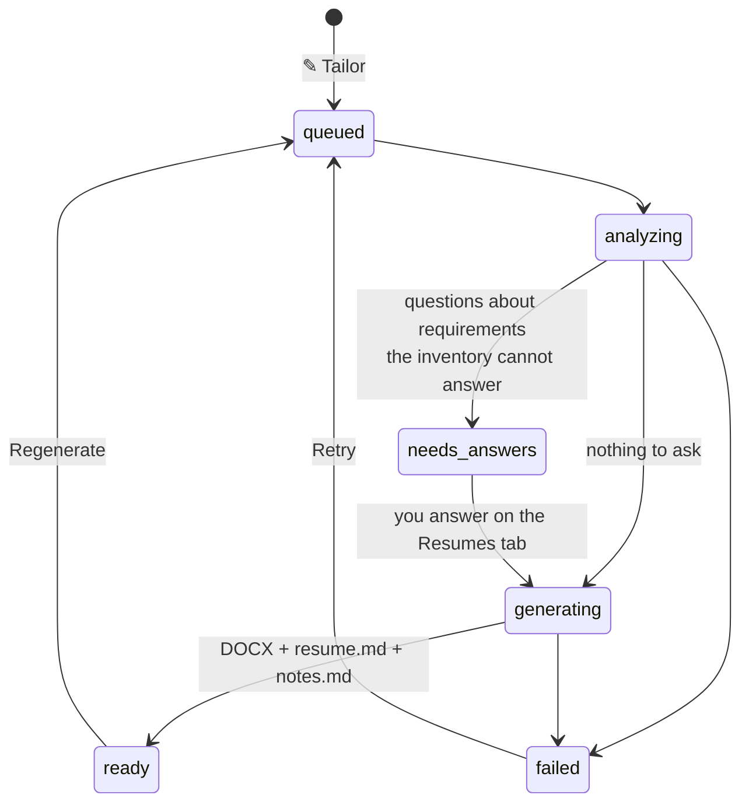

# Resume tailoring

Turns `resume/master-resume.md` + `skills-inventory.md` into a two-page, ATS-safe DOCX for one
posting, truthfully. Runs the `tailor-resume` Claude Code skill headlessly through your
subscription; nothing is typed into a chat.

## Running it

Tick jobs (or none, for the whole current list) and press **✎ Tailor resumes**. Jobs that are
citizen-only, already applied, already ready or in progress are skipped; the batch is capped
by `resume.batch_max`. Two workers run in parallel by default (`resume.parallel`, adjustable
live on the Resumes tab).

## The questions

*Analyze* reads the posting against your inventory and returns only the requirements it cannot
settle - "Do you have hands-on Vitess experience?" - as **have / familiar / don't have** with
an optional context line. Questions are grouped by job on the Resumes tab; each group has its
own *Submit & generate*. Answers are per application unless you tick **Also remember**, which
writes them into `skills-inventory.md` (the only path into the inventory). That is also how fit
scoring gets sharper over time.

## What you get

`resume/output/<Company>/<Role-slug>/<jobId>/`:

| File | Purpose |
|---|---|
| `<file_name>.docx` | the tailored two-page resume (name from `resume.file_name`) |
| `resume.md` | the same content in Markdown - what the filler reads when a form asks for employment or education blocks |
| `notes.md` | what was emphasised and why |
| `job.md` | snapshot of the posting |
| `qa.md`, `cover-letter.md`, `<stem>_Cover_Letter.docx`, `_short.docx` | on demand: application Q&A answers, long and short cover letters |

The Resumes tab's **Ready** list shows each finished job with Open resume / Folder / Notes /
Regenerate / Cover letter / Application Q&A, and the apply controls. Skipped or applied jobs
move to a collapsed **Finished** section.

## Rules the skill follows

- Claims come only from `master-resume.md` and the inventory. *familiar* may appear as
  familiarity; *dont-have* never appears.
- Layout and tone rules come from `preferences.md`; the page constants live in
  `scripts/build_docx.js` and are not restyled per job.
- The skill's wording is yours to own: `.claude/skills/tailor-resume/SKILL.md`.

## Settings

Settings → Resume tailoring: model (Fable 5.1 default), output folder, file name, `claude`
command, timeout, batch cap, parallel workers, and a **Test** button that checks the binary and
runs a one-line `claude -p`.
