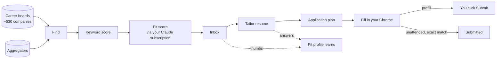

# JobScout

**A local job-search engine: aggregate → score → tailor → apply, all on your machine.**

JobScout pulls postings from hundreds of company career boards and a few aggregators, scores
each one twice (a fast keyword score, then a model-judged *fit* that tells "SRE who runs Kafka"
from "Kafka internals expert"), tailors a two-page resume per job, builds the application plan
from your profile, and fills the employer's form in your own Chrome for you to review or submit.
It learns from your thumbs-up/down and from the answers you give while tailoring.

## Why it exists

Job boards optimise for *their* funnel. A focused senior search needs the opposite: every
relevant posting from the employers that matter, judged against what you actually know, with
the repetitive work (tailoring, form filling) done for you but **never a decision made without
you**. JobScout is that, for one person, on one machine.

## What makes it different

| | JobScout |
|---|---|
| Where it runs | Your laptop. SQLite database, your resume files, your keys. Nothing hosted. |
| How it finds jobs | Direct from employers' applicant-tracking systems (Greenhouse, Lever, Ashby, Workday, …) plus aggregators. No scraping of LinkedIn/Indeed, no bot-protection bypass. |
| How it judges | A keyword prefilter you can edit, then a model fit score with a one-line reason and the gaps - through your own Claude subscription, no API key. |
| How it learns | Thumbs on fit scores rewrite your judgement rules; tailoring answers grow your skills inventory. |
| How it applies | Reads the form, resolves every field from your profile, shows you the plan. Prefill leaves the tab for your Submit; unattended submits only on an exact match. Never captchas, logins or account creation. |
| Who it's for | One person per install. Home metro and role preset are settings (SRE/DevOps and QA/SDET ship today). |

## Where to go next

- **[Installation](getting-started/installation.md)** → **[Quickstart](getting-started/quickstart.md)** → **[Make it yours](getting-started/make-it-yours.md)**: running with a scored inbox in 15 minutes.
- **[Terminology](concepts/terminology.md)** if ATS, slug, category 2, fit score, prefill are new words.
- **[Architecture](concepts/architecture.md)** for the moving parts.
- **[User guide](guide/jobs.md)** page by page.
- **[Configuration](reference/configuration.md)** for every setting.
